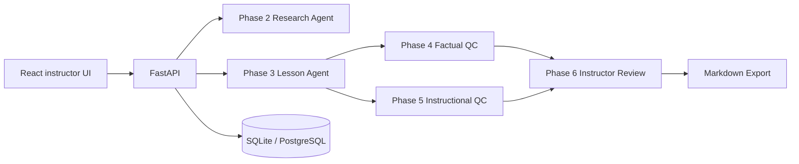

# Kalvium AI-Powered Lesson Creation Tool

A full-stack foundation for creating research-backed, quality-controlled classroom lessons in under 45 minutes.

## Technology stack

- Frontend: React, TypeScript, Vite, Tailwind CSS
- Backend: Python, FastAPI, Pydantic, SQLAlchemy
- Database: SQLite for local development; architecture supports PostgreSQL
- Future integrations: Gemini/OpenAI, Tavily/web research, Google Books/Open Library, YouTube Data API

## Prerequisites

- Node.js 18+
- Python 3.10+
- npm

## Setup

```bash
cd kalvium-lesson-ai/backend
python3 -m venv .venv
source .venv/bin/activate
pip install -r requirements.txt
cp .env.example .env
uvicorn app.main:app --reload
```

The backend runs at `http://localhost:8000`.

```bash
cd kalvium-lesson-ai/frontend
npm install
cp .env.example .env
npm run dev
```

The frontend runs at `http://localhost:5173`.

## Environment variables

Backend variables are in `backend/.env.example`. Frontend variables are in `frontend/.env.example`. Never commit real API keys or secrets.

## API endpoints

| Method | Path | Purpose |
|---|---|---|
| GET | `/` | API identity and status |
| GET | `/health` | API and database health |

## Phase 1 status

Implemented: project structure, environment configuration, CORS, SQLite/SQLAlchemy setup, database health check, FastAPI health endpoints, React dashboard shell, navigation placeholders, and backend connection status.

Not implemented yet: research integrations, AI agents, lesson generation, quality-control agents, editing/saving, QC application, retry workflows, and export. Stop here and approve Phase 2 before implementing research or generation.

## Research API endpoints

| Method | Path | Purpose |
|---|---|---|
| POST | `/research` | Research a query across web, books, and YouTube |
| GET | `/research` | List stored research requests |
| GET | `/research/{id}` | Retrieve one research request and its sources |
| POST | `/research/{id}/retry` | Retry providers for a stored request |

Example:

```bash
curl -X POST http://localhost:8000/research \
  -H 'Content-Type: application/json' \
  -d '{"query":"photosynthesis","max_results":5}'
```

## Research provider configuration

Set these optional environment variables in `backend/.env`:

```text
TAVILY_API_KEY=
YOUTUBE_API_KEY=
RESEARCH_TIMEOUT_SECONDS=15
RESEARCH_RETRY_ATTEMPTS=3
```

Open Library and a keyless Crossref scholarly-source fallback require no API key. Tavily improves general educational web coverage when configured. YouTube requires a YouTube Data API key.

## Research verification

Run provider and resilience tests:

```bash
cd kalvium-lesson-ai/backend
source .venv/bin/activate
pytest tests/test_research_providers.py tests/test_research_resilience.py -q
pytest
```

Live provider verification can be performed with provider keys:

```bash
export TAVILY_API_KEY="your-key"
export YOUTUBE_API_KEY="your-youtube-data-api-v3-key"
```

Tavily and YouTube requests are live only when their corresponding keys are configured. Open Library and Crossref are public live integrations and require no key. Never commit `.env` files or API keys. If `YOUTUBE_API_KEY` is missing, the API reports a configuration error and no synthetic video sources are returned.

Verify persisted sources:

```bash
curl -X POST http://localhost:8000/research -H 'Content-Type: application/json' -d '{"query":"photosynthesis","max_results":5}'
curl http://localhost:8000/research/1
```

## Phase 2 status

Implemented: persisted research requests and normalized sources, provider retries and timeouts, partial/failed provider status reporting, retry endpoint, Crossref/Tavily web research, Open Library books, and YouTube Data API support. Test cases cover each provider independently.

Not implemented yet: lesson generation, research-backed lesson composition, both QC agents, instructor editing/saving, QC recommendation application, and export.

## Lesson generation API

| Method | Path | Purpose |
|---|---|---|
| POST | `/lessons/generate` | Research and generate a structured lesson |
| GET | `/lessons` | List saved lessons, including failed generation records |
| GET | `/lessons/{id}` | Retrieve a generated lesson |

Configure one modular LLM provider in `backend/.env`:

```text
AI_PROVIDER=gemini
GEMINI_API_KEY=
GEMINI_MODEL=gemini-2.0-flash

# Alternative
AI_PROVIDER=openai
OPENAI_API_KEY=
OPENAI_MODEL=gpt-4o-mini
```

Generation uses the existing research service before calling the provider. Retrieved URLs are retained as factual references and the returned JSON is validated before saving. Generated duration sections must total no more than 45 minutes, knowledge checks must contain 3–5 questions, and references must be present in the retrieved research.

## Phase 3 status

Implemented: validated generation requests, research-service reuse, structured lesson persistence, Gemini/OpenAI provider interfaces, JSON response validation, 45-minute duration enforcement, research-grounded reference validation, retryable failed records, and generation/list/retrieve endpoints. QC agents and PDF export are not implemented.

## Factual Accuracy QC API

| Method | Path | Purpose |
|---|---|---|
| POST | `/lessons/{lesson_id}/qc/factual` | Run Research and Factual Accuracy QC |
| GET | `/lessons/{lesson_id}/qc/factual` | List factual QC reports |
| GET | `/lessons/{lesson_id}/qc/factual/{report_id}` | Retrieve one factual QC report |

The factual auditor uses the lesson's linked Phase 2 research sources only. Unsupported evidence is reported as uncertainty rather than treated as proof of falsehood. Citations are filtered against retrieved URLs, and the score combines claim-status weights with severity deductions.

## Phase 4 status

Implemented: factual claim extraction prompt, evidence-based verification statuses, source-citation allowlisting, contradiction and missing-evidence issue structures, severity classification, transparent programmatic scoring, persisted QC reports, and factual QC API endpoints. QC Agent 2 and export are not implemented.

## Instructional Quality QC API

| Method | Path | Purpose |
|---|---|---|
| POST | `/lessons/{lesson_id}/qc/instructional` | Run instructional QC |
| GET | `/lessons/{lesson_id}/qc/instructional` | List instructional QC reports |
| GET | `/lessons/{lesson_id}/qc/instructional/{report_id}` | Retrieve one report |

Instructional QC evaluates objective alignment, clarity, progression, examples, applications, activity design, knowledge checks, and realistic 45-minute pacing. It does not modify the lesson. Scores are weighted programmatically from seven criterion percentages and capped severity deductions. Failed or invalid lesson evaluations are persisted as failed reports.

## Phase 5 status

Implemented: independent instructional quality auditing, Gemini evaluation, transparent weighted scoring, persisted reports, execution/history/retrieval endpoints, and a dedicated frontend Instructional Quality tab. Lesson editing, export, and QC Agent 3 capabilities are not implemented.

## Instructor review and export

```text
PUT  /lessons/{lesson_id}/edit
GET  /lessons/{lesson_id}/edit
POST /lessons/{lesson_id}/recommendations/apply
GET  /lessons/{lesson_id}/export.markdown
```

The instructor review page loads generated content, displays the latest QC Agent 1 and QC Agent 2 reports, allows section editing, applies accepted recommendations, previews current edits, and downloads Markdown. Generated content remains in `lessons.content`; instructor versions are stored in `lesson_edits`. Recommendation applications are recorded separately.

The Markdown export contains the final edited lesson, references, QC Agent 1 report, and QC Agent 2 report.

## Phase 6 and final export status

Implemented: instructor section editing, persistent instructor versions, recommendation application, final preview, and Markdown export of the final lesson, references, factual QC, and instructional QC. Editing never overwrites generated content. PDF export and instructor workflow extensions are intentionally not implemented.

---

## Final submission overview

Kalvium Lesson AI is a full-stack application for researching, generating, fact-checking, instructionally reviewing, editing, and exporting classroom lessons designed to fit within 45 minutes.

## Architecture

The React frontend communicates with a modular FastAPI backend. SQLAlchemy persists research requests and sources, generated lessons, instructor edits, recommendation applications, and both QC report types. SQLite is used locally and PostgreSQL-compatible database configuration remains supported.



## Complete setup

### Backend

```bash
cd kalvium-lesson-ai/backend
python3 -m venv .venv
source .venv/bin/activate
pip install -r requirements.txt
cp .env.example .env
uvicorn app.main:app --reload
```

### Frontend

```bash
cd kalvium-lesson-ai/frontend
npm install
cp .env.example .env
npm run dev
```

## Environment configuration

Never commit keys. Configure `backend/.env` from `backend/.env.example`:

```text
TAVILY_API_KEY=
YOUTUBE_API_KEY=
AI_PROVIDER=gemini
GEMINI_API_KEY=
GEMINI_MODEL=gemini-2.5-flash
OPENAI_API_KEY=
OPENAI_MODEL=gpt-4o-mini
RESEARCH_TIMEOUT_SECONDS=15
RESEARCH_RETRY_ATTEMPTS=3
```

Configure `frontend/.env` with:

```text
VITE_API_BASE_URL=http://localhost:8000
```

## Core features

- Research from educational websites, Open Library books, and YouTube.
- Gemini/OpenAI lesson generation with 45-minute duration validation.
- Separate factual accuracy and instructional quality QC reports.
- Section editing and persistent instructor versions.
- Selective QC recommendation application.
- Final preview and Markdown export containing lesson, references, and both reports.

## Main API endpoints

```text
POST /research
GET  /research
GET  /research/{id}
POST /lessons/generate
GET  /lessons
GET  /lessons/{id}
POST /lessons/{lesson_id}/qc/factual
GET  /lessons/{lesson_id}/qc/factual
POST /lessons/{lesson_id}/qc/instructional
GET  /lessons/{lesson_id}/qc/instructional
PUT  /lessons/{lesson_id}/edit
GET  /lessons/{lesson_id}/edit
POST /lessons/{lesson_id}/recommendations/apply
GET  /lessons/{lesson_id}/export.markdown
```

## Demo workflow

1. Start backend and frontend.
2. Create research for “HTTP Requests and Responses.”
3. Generate a lesson through the backend UI/API.
4. Run factual QC and instructional QC.
5. Open Instructor Review, edit sections, apply recommendations, save, and refresh.
6. Download the Markdown export.
7. Confirm the export includes references and both QC sections.

## Submission verification

```bash
cd kalvium-lesson-ai/backend
source .venv/bin/activate
python -m pytest -q

cd ../frontend
npm run build
```
