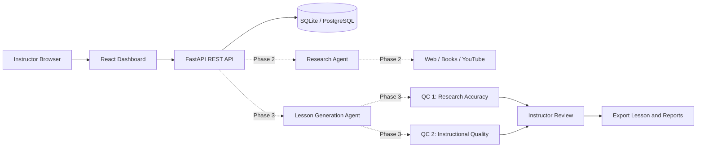

# Architecture

## System overview

## Frontend architecture

Vite serves the React and TypeScript application. Tailwind supplies styling. Feature folders separate layouts, pages, reusable components, hooks, API services, types, and utilities. `useBackendHealth` owns the health-request lifecycle and retries are user-triggerable.

## Backend architecture

FastAPI routes, configuration, database setup, schemas, models, services, agents, and utilities are separated under the application package. Phase 1 exposes root and health routes only. API behavior will remain service-oriented so orchestration can be added without coupling routes to providers.

## Database architecture

SQLAlchemy uses an engine and session factory configured from environment variables. SQLite is the initial local database; PostgreSQL-compatible SQLAlchemy configuration can be selected with `DATABASE_URL`. Lesson-specific models are intentionally not created in Phase 1.

## Future Research Agent

The agent will accept lesson requirements, use configured research providers, collect sources from approved web, book, and YouTube APIs, normalize results, and retain source metadata needed for citations and factual verification.

## Future Lesson Generation Agent

The generation service will synthesize structured, instructor-editable lesson content constrained to 45 minutes. It will use objectives, research evidence, and timestamps or durations to preserve traceability and fit learning outcomes.

## Future QC Agent 1

Research and Factual Accuracy will evaluate every substantive claim against collected evidence, identify unsupported claims, assess source reliability, and return actionable findings with source references.

## Future QC Agent 2

Instructional Quality will evaluate alignment to the objective, pacing, engagement, accessibility, assessment opportunities, prerequisite knowledge, and lesson duration. It will produce independent recommendations without altering generated content.

## Instructor review and export workflow

Future APIs will support draft retrieval, instructor edits, saving, applying recommendations independently, and finalization. Export will bundle the lesson, references, QC 1 report, and QC 2 report. Provider and database failures will be represented by explicit API errors and retryable operations.

## Instructor review and export

Phase 6 stores instructor versions separately from immutable generated lesson content. `lesson_edits` holds saved review versions and `recommendation_applications` records accepted QC recommendations. Both are associated with the original lesson ID.

The review API supports loading the latest edit, saving edits, applying recommendations to named sections, and exporting Markdown. Export selects the latest instructor edit, retrieves original references and the latest completed factual/instructional reports, and produces one submission file containing lesson content, references, QC Agent 1, and QC Agent 2.

## Research Agent implementation

The Phase 2 Research Agent is exposed through `POST /research`, `GET /research`, `GET /research/{id}`, and `POST /research/{id}/retry`. It searches three independent source categories and stores normalized, deduplicated results.

- Web: Tavily when `TAVILY_API_KEY` is configured; otherwise Crossref scholarly metadata.
- Books: Open Library public search API.
- YouTube: YouTube Data API when `YOUTUBE_API_KEY` is configured.

Each provider has a bounded timeout, exponential backoff retries for transient failures, and provider-specific error handling. A provider failure does not automatically discard successful sources; the request status becomes `partial`. The persistence tables are `research_requests` and `research_sources`. Every source retains title, URL, source type, author/publisher or channel, description, and provider.

Future lesson and QC phases consume these stored source records. No automatic research claims, generated references, or fabricated media links are accepted: URLs and source metadata come only from provider responses.

## Lesson Generation Agent implementation

`POST /lessons/generate` validates lesson inputs, invokes the existing Phase 2 research service, passes normalized provider results to a selected LLM, validates the JSON response, and persists the lesson. The Gemini and OpenAI integrations share an `LLMProvider` interface, so provider-specific HTTP handling remains isolated from generation orchestration.

Generated lessons are stored in `lessons`. Each record retains its research request, provider name, missing source categories, structured content, and generation status/error. Generation is grounded by an allowlist of research URLs. The response validator rejects invented references, malformed structures, invalid knowledge-check counts, and durations exceeding 45 minutes.

Generation failures return a meaningful API error while retaining the failed lesson record. Lesson generation does not implement either QC agent or export.

## QC Agent 1: Research and Factual Accuracy

Phase 4 adds a separate factual audit workflow under `/lessons/{lesson_id}/qc/factual`. It reads the generated lesson and its linked Phase 2 research request, submits both plus normalized source metadata to the configured Gemini/OpenAI provider, and validates all returned citations against the retrieved URL allowlist.

Claims receive verified, contradicted, unsupported, partially supported, or unverifiable status. Issues retain exact lesson text, section, category, severity, explanation, evidence, source metadata, and suggested correction. The overall score is calculated from claim-status weights and severity deductions documented in each report; it is not inferred directly by the LLM.

Reports are stored in `factual_qc_reports`. Instructional quality remains outside this phase and is reserved for QC Agent 2.

## QC Agent 2: Instructional Quality

Phase 5 adds a separate instructional evaluation under `/lessons/{lesson_id}/qc/instructional`. It reads the generated lesson and learning objective, but does not inspect research or factual claims. The Gemini/OpenAI provider evaluates objective alignment, clarity, logical progression, examples, applications, activity, knowledge checks, pacing, missing concepts, and instructional gaps.

Reports are stored in `instructional_qc_reports` and exposed through execute, history, and detail endpoints. The frontend includes an Instructional Quality tab that defaults to lesson 29 and supports running or loading reports. The overall score combines documented criterion weights and severity deductions programmatically. QC never changes lesson content.
